# Лабораторная работа №6. Система контроля версий

**Выполнил:** Попков И. Р., группа 4515
**ГУАП**

**Цель работы:** изучение базовых возможностей системы управления версиями, опыт работы с Git API, опыт работы с локальным и удалённым репозиторием.

**Используемые инструменты:** Git for Windows (Git Bash), GitHub, Visual Studio Code (редактор сообщений коммитов и отчёта), Блокнот Windows, Проводник Windows.

---

## 1. Создание аккаунта на GitHub

На сайте GitHub зарегистрирован аккаунт с логином `ExoDus234`. На скриншоте показана страница профиля: на ней видны список репозиториев и график активности.

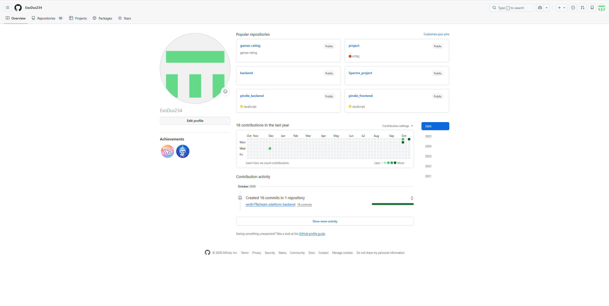

## 2. Fork репозитория

**Fork** — это копия чужого репозитория в собственном аккаунте GitHub. Изменять оригинал `Kurtyanik/LR6` можно только с правами владельца, а в своей копии разрешены любые изменения. Связь с оригиналом при этом сохраняется: это видно по надписи *forked from Kurtyanik/LR6*.

На странице оригинала нажата кнопка **Fork**. В качестве владельца выбран аккаунт `ExoDus234`, имя репозитория осталось `LR6`, затем нажата кнопка **Create fork**.

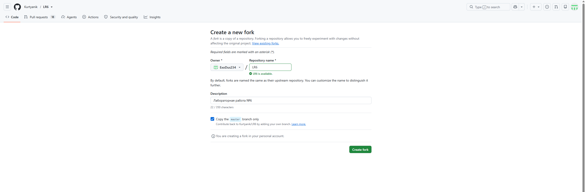

В результате создан репозиторий `https://github.com/ExoDus234/LR6`. В нём три коммита из оригинала и два файла: `README.md` и `mergefile.txt`. Ветка одна, `master`.

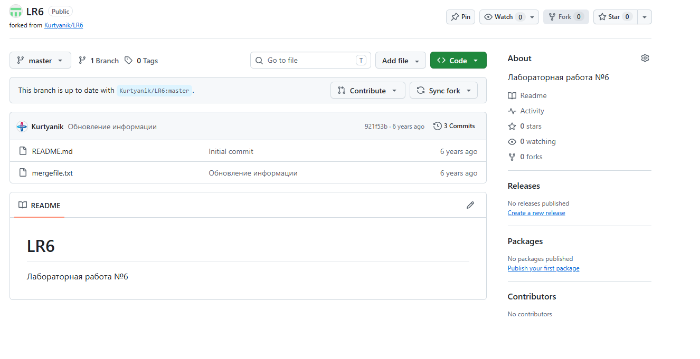

## 3. Установка Git

С официального сайта https://git-scm.com/ установлен Git for Windows. Вместе с ним ставится терминал **Git Bash**, в котором выполнялись все команды лабораторной работы. Приглашение `ivanp@SPECTRE UCRT64 ~` состоит из имени пользователя, имени компьютера и текущей папки. Знак `~` обозначает домашнюю папку.

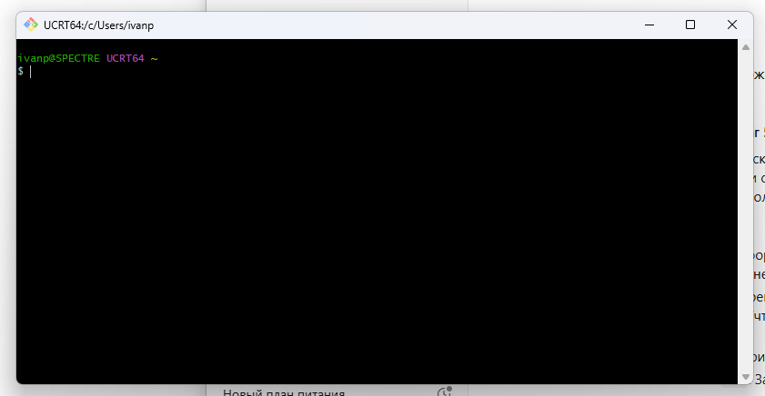

## 4. Настройка клиента Git

Каждый коммит в Git подписывается именем автора и email. Настройки задаются командой `git config`. У этой команды три уровня:

| Уровень | Флаг | Где действует | Где хранится |
|---|---|---|---|
| системный | `--system` | все пользователи компьютера | в папке установки Git |
| глобальный | `--global` | все репозитории текущего пользователя | `~/.gitconfig` |
| локальный | `--local` | только текущий репозиторий | `.git/config` |

Если параметр задан на нескольких уровнях, действует самый «узкий» из них, то есть локальный. На компьютере уже был настроен глобальный профиль для личных проектов. Поэтому имя в формате «Группа Фамилия И.О.» и email заданы **локально**, только для репозитория лабораторной. Глобальные настройки остались без изменений.

Команды выполнялись внутри папки клонированного репозитория, потому что локальная настройка привязана к конкретному репозиторию. Если вызвать `git config` со значением, параметр записывается; без значения команда выводит текущий параметр. При успешной записи Git ничего не выводит.

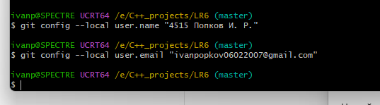

Проверка: команды без значения вывели заданные имя и email.

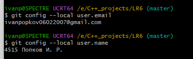

## 5. Клонирование репозитория

Команда `git clone <url>` скачивает удалённый репозиторий целиком, со всей историей коммитов, и создаёт локальную копию в новой папке. Адрес, с которого склонирован репозиторий, сохраняется под именем `origin`. По этому имени дальше выполняются `pull` и `push`.

Переход в нужную папку выполнен командой `cd /e/C++_projects`. В Git Bash диски записываются как каталоги в корне: `E:` превращается в `/e`. Поэтому первая попытка с путём в стиле Windows (`AppDisk (E:)`) завершилась ошибкой. Затем склонирован **свой** форк, `https://github.com/ExoDus234/LR6.git`, а не репозиторий преподавателя.

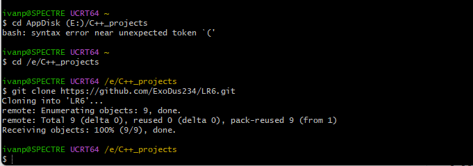

В папке `E:\C++_projects` появилась папка `LR6`. Внутри неё скрытая папка `.git`: это и есть сам репозиторий, где лежат история, ветки и настройки.

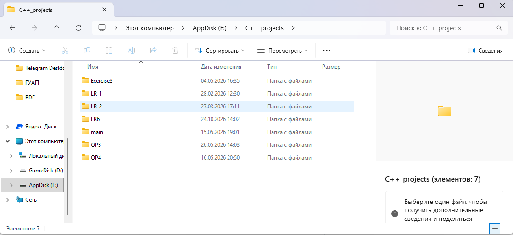

## 6. Добавление файла через GitHub и pull

Через веб-интерфейс GitHub (**Add file → Create new file**) в ветке `master` создан файл `Step6`, коммит `8681fe9`. Теперь удалённый репозиторий на один коммит опережает локальный: на GitHub так и написано, *1 commit ahead of Kurtyanik/LR6:master*.

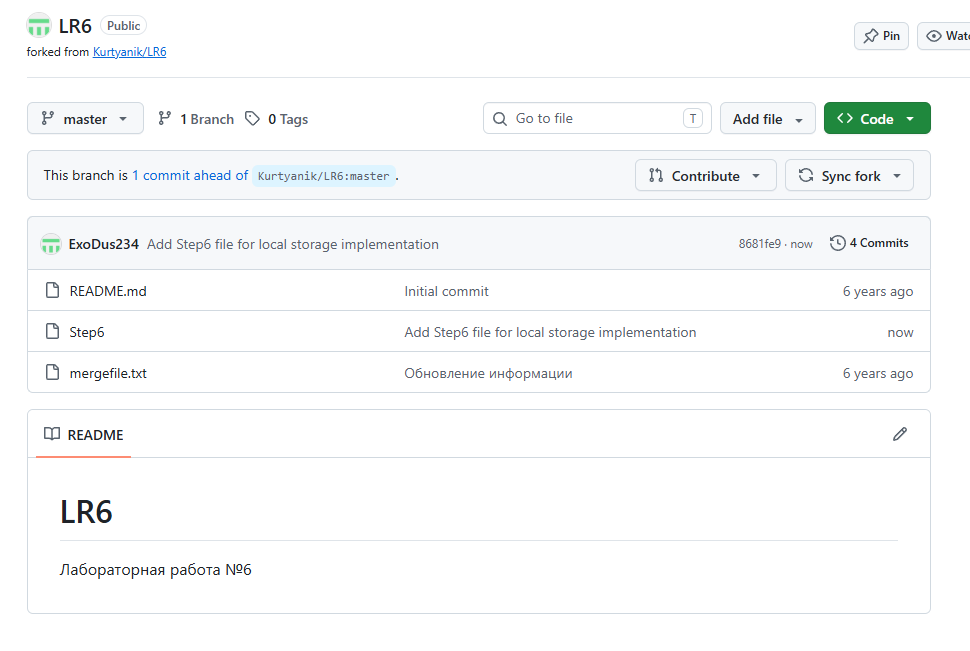

Есть две команды для получения изменений:
- `git fetch` только скачивает новые коммиты и обновляет `origin/master`, рабочие файлы при этом не меняются;
- `git pull` — это `fetch` и сразу `merge` в текущую ветку.

Выполнен `git pull`. В выводе видно `Updating 921f53b..8681fe9` и `Fast-forward`. **Fast-forward** означает, что в локальной ветке не было своих новых коммитов, поэтому Git просто передвинул указатель `master` вперёд, на новый коммит, без создания merge-коммита. После этого файл `Step6` появился в локальной папке.

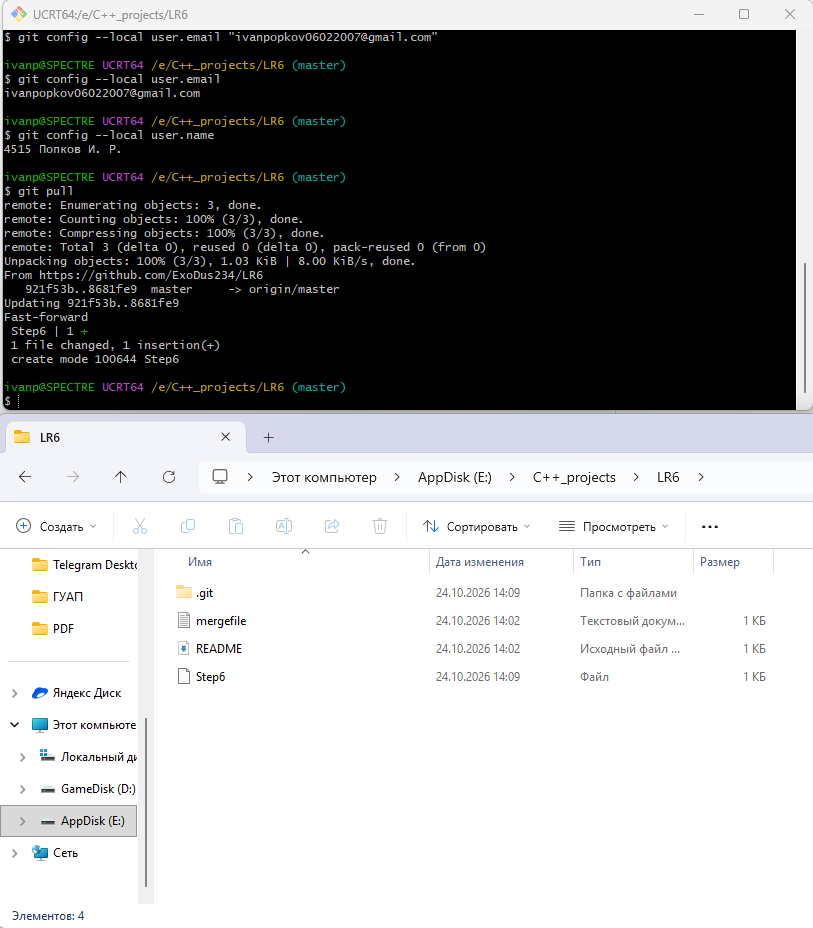

---

*Далее работа выполнялась локально.*
## 7. История операций для каждой ветки

**Ветка** в Git — это подвижный указатель на последний коммит линии разработки. `HEAD` указывает на ветку, в которой сейчас ведётся работа.

Сначала выведен список веток командой `git branch -a`. Флаг `-a` показывает и локальные ветки, и удалённые (`remotes/origin/...`). Звёздочкой отмечена текущая ветка. Кроме `master` в репозитории веток нет: в исходном репозитории преподавателя тоже только `master`.

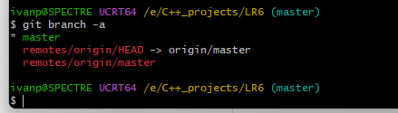

Поэтому для слияния с конфликтом побочная ветка создана самостоятельно. Команда `git switch -c feature` создаёт ветку `feature` от текущего коммита и сразу переключается на неё. Флаг `-c` означает create. Для этого раньше использовалась команда `git checkout -b feature`.

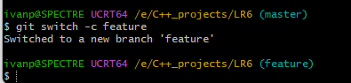

Чтобы получить конфликт, нужно изменить **одни и те же строки одного файла по-разному в двух ветках**. Это сделано так:
1. В ветке `feature` первая строка файла `mergefile.txt` заменена на «Файл (корректировка)». Изменение зафиксировано коммитом `190d606 Added some letters`.
2. Затем выполнено переключение на `master`. После переключения в файле снова исходный текст, так как изменение принадлежит только ветке `feature`.
3. В `master` первая строка заменена на «Файл (корректировка для мастер)». Изменение зафиксировано коммитом `4872feb Added info in branch master`.

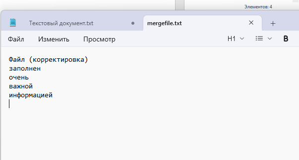

Фиксация изменений идёт в два этапа. `git add` добавляет изменения в **индекс** (staging area), то есть подготавливает их к коммиту; точка значит «все изменения в текущей папке». `git commit -m "..."` создаёт коммит из содержимого индекса, а флаг `-m` задаёт комментарий.

История каждой ветки выведена командой `git log --oneline`. Флаг `--oneline` показывает каждый коммит одной строкой: сокращённый хэш и комментарий. На скриншоте ниже (верхняя часть) видно, что обе ветки содержат общие коммиты до `8681fe9`, а дальше у каждой свой: `4872feb` в `master` и `190d606` в `feature`. Метка `origin/master` показывает, до какого коммита дошёл удалённый репозиторий. Новые локальные коммиты на GitHub пока не отправлены.

## 8. Просмотр последних изменений

Разница между ветками просмотрена командой `git diff master feature`. Как читать вывод:
- `--- a/mergefile.txt` — версия файла из `master`, `+++ b/mergefile.txt` — версия из `feature`;
- `@@ -1,5 +1,5 @@` — фрагмент файла, строки с 1-й по 5-ю в обеих версиях;
- строки с `-` (красные) есть только в `master`, строки с `+` (зелёные) только в `feature`;
- строки без знака («важной», «информацией») совпадают;
- красные прямоугольники в конце строк — лишние пробелы, добавленные в ветке `feature`. Git тоже считает их изменением, поэтому различаются три строки, а не одна.

Ещё последние изменения можно посмотреть командой `git show`. Она выводит последний коммит: автора, дату, комментарий и изменения в формате diff.

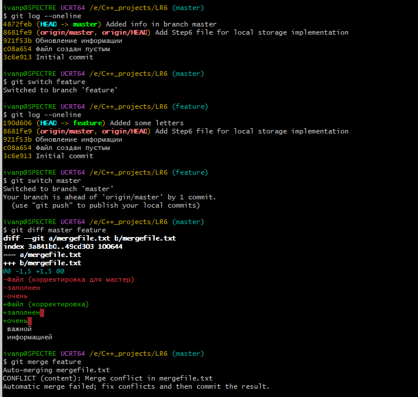

## 9. Слияние в master с разрешением конфликта

Слияние выполняется из той ветки, **в которую** вливаются изменения. Поэтому сначала выполнено переключение на `master`, затем `git merge feature`.

Обе ветки изменили одни и те же строки, и Git не может сам выбрать правильный вариант. Он вывел `CONFLICT (content): Merge conflict in mergefile.txt` и `Automatic merge failed`, а приглашение консоли сменилось на `(master|MERGING)`. Это значит, что слияние начато, но не завершено.

`git status` показывает файл в разделе *Unmerged paths* с пометкой `both modified`: файл изменён в обеих ветках. В самом файле Git расставил маркеры конфликта:
- `<<<<<<< HEAD` — начало варианта из текущей ветки (`master`);
- `=======` — разделитель вариантов;
- `>>>>>>> feature` — конец варианта из вливаемой ветки.

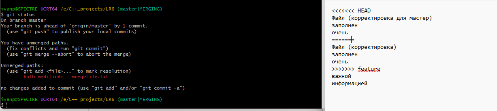

Конфликт разрешён вручную: файл открыт в редакторе, оставлен итоговый вариант текста, все три строки-маркера удалены. Затем:
1. `git add .` — для Git добавление файла в индекс означает, что конфликт разрешён;
2. `git commit` без `-m`. Git открыл редактор (VS Code) с готовым сообщением `Merge branch 'feature'` и списком конфликтных файлов. Строки, начинающиеся с `#`, — комментарии, они не попадают в сообщение. После сохранения и закрытия файла коммит был создан.

Результат показан командой `git log --oneline --graph`. Флаг `--graph` рисует историю в виде графа: от `8681fe9` расходятся две линии (`4872feb` и `190d606`), и они сходятся в merge-коммите `e0d2e04`. У merge-коммита два родителя, по одному из каждой ветки.

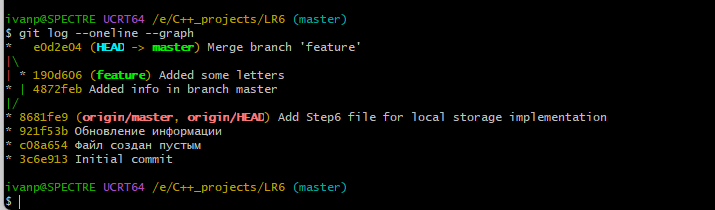

## 10. Удаление побочной ветки

После слияния ветка `feature` больше не нужна. Она удалена командой `git branch -d feature`, Git ответил `Deleted branch feature (was 190d606)`.

- `-d` удаляет ветку только если она уже влита в текущую ветку. Это защита от потери коммитов;
- `-D` удаляет ветку принудительно, даже с невлитыми коммитами.

Удаляется только указатель. Сами коммиты ветки остались в истории `master`, потому что на них ссылается merge-коммит. Ветка `feature` существовала только локально, поэтому удалять её на GitHub не требовалось.

## 11. Несколько изменений с комментариями

Сделаны три изменения. Каждое зафиксировано отдельным коммитом (`git add .`, затем `git commit -m`) с комментарием, описывающим суть изменения:

| Коммит | Комментарий | Что изменено |
|---|---|---|
| `4722f0a` | Added Ex1 | создан файл `Ex1.txt` |
| `7e3e99e` | Added info in Step6 | изменена строка в файле `Step6` |
| `135127c` | Added ForDelete | создан файл `ForDelete.txt`, его коммит потом отменяется |

В выводе `git commit` видна статистика: сколько файлов изменено, сколько строк добавлено (`insertion(+)`) и удалено (`deletion(-)`). Строка `create mode 100644` означает, что создан новый обычный файл. В проводнике видно, что все файлы появились в рабочей папке.

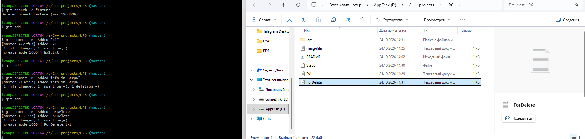

## 12. Откат коммита

В Git есть два основных способа отката:

| | `git revert <коммит>` | `git reset <коммит>` |
|---|---|---|
| Что делает | создаёт **новый** коммит с обратными изменениями | передвигает указатель ветки назад |
| История | сохраняется полностью | последующие коммиты исчезают из ветки |
| Отправленные коммиты | безопасно | нельзя, иначе история расходится с удалённой |
| Режимы | — | `--soft` (изменения остаются в индексе), `--mixed` (в рабочей папке), `--hard` (удаляются совсем) |

Выбран `git revert`: он не переписывает историю, и откат виден в логе. Хэш коммита для отмены (`135127c`) взят из `git log --oneline`. После команды `git revert 135127c` Git открыл редактор с сообщением `Revert "Added ForDelete"` и строкой `This reverts commit 135127c...`. В списке изменений указано `deleted: ForDelete.txt`.

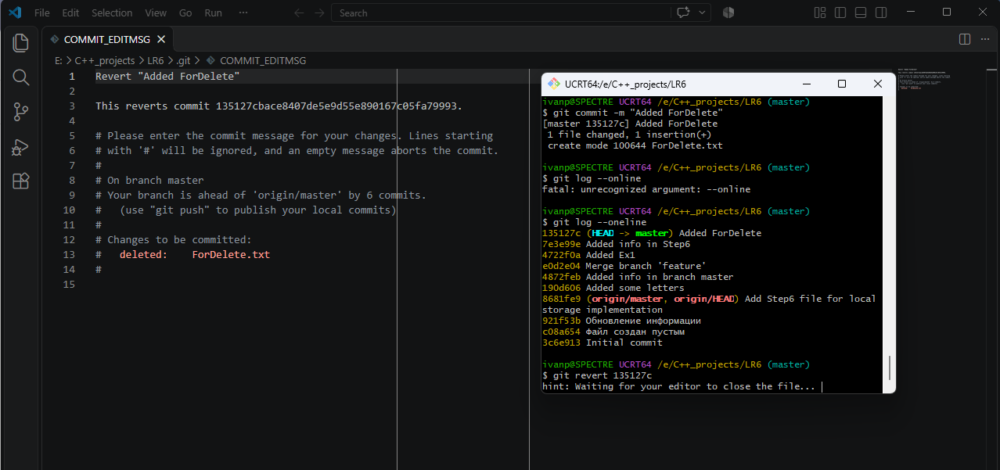

После сохранения сообщения файл `ForDelete.txt` пропал из рабочей папки.

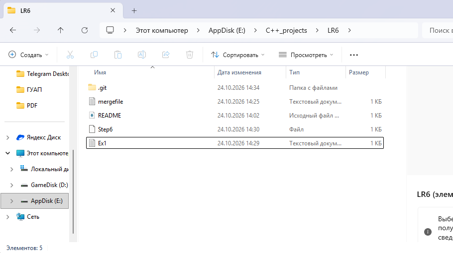

В истории появился новый коммит `51a09f5 Revert "Added ForDelete"`, при этом исходный коммит `135127c` остался на месте. В этом и состоит отличие `revert` от `reset`.

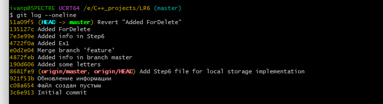

## 13. Ветка для отчёта

Командой `git switch -c report` создана ветка `report`, и выполнено переключение на неё. Отчёт оформлялся в отдельной ветке, чтобы его изменения не смешивались с основной веткой `master`.